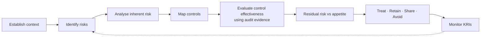

# Identity & Authentication Risk Assessment

**Client:** Kestrel Ledger Ltd. *(fictitious)* · **System:** Kestrel AP platform and supporting identity infrastructure

| Field | Detail |
|---|---|
| Document ID | GRC-RA-IAM-2026 |
| Version | 1.1 — residual ratings updated for audit results |
| Assessment dates | 12 June 2026 (v1.0, audit planning) · 15 September 2026 (v1.1, post-fieldwork) |
| Document owner | Kestrel management — prepared by the GRC Manager *(fictitious)* |
| Risk owner | Chief Information Security Officer (CISO), Kestrel Ledger Ltd. |
| Portfolio author | A. Huttener — written as a client document for this simulated case study |
| Approved by | Kestrel Risk Committee — 22 September 2026 |
| Methodology | ISO/IEC 27005:2022 and ISO 31000:2018 risk process; NIST SP 800-30 Rev. 1 for threat-scenario construction |
| Related documents | [Compliance mapping](compliance-mapping-soc2-iso.md) · [Control testing program](../02-audit-testing-workpapers/control-testing-program.md) · [Findings & remediation](../02-audit-testing-workpapers/audit-finding-and-remediation.md) · [IAM Policy](../03-policy-governance/identity-access-management-policy.md) |

---

## 1. Purpose

This assessment identifies, analyses and evaluates risks arising from how Kestrel Ledger Ltd. ("Kestrel") establishes identities, authenticates users, and grants, reviews and removes access. It serves two audiences:

1. **Kestrel's ISMS** — it is the identity-domain input to the information security risk assessment and risk treatment required by ISO/IEC 27001:2022 Clauses 6.1.2, 6.1.3, 8.2 and 8.3, and it informs the Statement of Applicability (SoA).
2. **The service auditor** — who evaluates Kestrel's risk assessment process as evidence for CC3.2 and considers it, alongside the auditor's own engagement risk assessment, when deciding which controls are *key*, where walkthroughs focus and which sample sizes apply in the [control testing program](../02-audit-testing-workpapers/control-testing-program.md). The auditor does not prepare or approve this document.

Version 1.1 re-rates control effectiveness and residual risk using the results of SOC 2® Type 2 fieldwork (July–August 2026).

## 2. Context and scope

### 2.1 Business context

Kestrel provides **Kestrel AP**, a multi-tenant SaaS platform that automates supplier-invoice capture, approval workflows and payment-file generation for ~600 mid-market customers in Ireland, the United Kingdom and the United States. The platform is hosted in AWS (eu-west-1). It stores customer invoice data, supplier master data — including **supplier bank account details** — and personal data of supplier contacts and customer users. Some US healthcare customers submit invoices that contain protected health information (PHI); Kestrel has signed Business Associate Agreements (BAAs) with them and is a **HIPAA business associate** for that data.

Identity is therefore a primary control boundary: a former worker or an external attacker with access to production could exfiltrate personal data or alter supplier bank details to redirect payments. Customers rely on Kestrel's SOC 2® Type 2 report and ISO/IEC 27001 certificate in their own vendor due diligence, so control failures also carry assurance and commercial consequences.

### 2.2 Identity populations in scope

| Population | Count at 30 Jun 2026 | Authoritative source | Access path |
|---|---|---|---|
| Employees | 380 | HiBob (HRIS) | Okta SSO — HR-driven lifecycle (automated) |
| Contractors | 38 | Procurement contract register *(moved into HiBob in September 2026)* | Okta SSO — manually administered by IT Service Desk |
| Privileged identities | 21 | Okta Identity Governance (eligibility list) | Just-in-time (JIT) elevation |
| Non-human identities (NHIs) | 31 | NHI inventory (CMDB) | API tokens, workload roles, application database roles |
| Legacy named local database accounts | 5 at period start · 3 at 30 Jun 2026 | **None — gap** | Direct PostgreSQL authentication |
| Customer (tenant) users | ~9,800 | Administered by each customer | Kestrel AP application, optionally via the customer's own IdP |

### 2.3 Systems in scope

| Tier | System | Purpose |
|---|---|---|
| Tier 1 | Okta Workforce Identity (incl. Okta Identity Governance) | Identity provider, SSO, MFA, access requests and certifications |
| Tier 1 | AWS production accounts via AWS IAM Identity Center | Hosting of Kestrel AP |
| Tier 1 | Amazon RDS for PostgreSQL (production) | Customer, invoice and supplier data |
| Tier 1 | GitHub Enterprise Cloud | Source code and CI/CD pipelines |
| Tier 1 | Kestrel AP Admin Console | Internal support tool with access to customer tenants |
| Supporting | HiBob · Jira Service Management · Splunk Cloud | HR source of truth · approvals and tickets · log retention and alerting |

### 2.4 Out of scope

Physical access, endpoint management, network security, cryptography and key management are assessed in separate domain assessments. Access administered by customers to their own Kestrel AP tenants is included only as a shared risk (R-11).

## 3. Methodology

### 3.1 Process

Risks were identified in two workshops (CISO, IAM Lead, Cloud Platform Lead, Head of People Operations, IT Service Desk Lead, GRC Manager) and through documentation review. Each risk is expressed as **cause → event → consequence**, analysed for **inherent** risk (before the IAM controls listed), mapped to controls, and re-analysed for **residual** risk using evidence of control effectiveness from audit testing.

### 3.2 Likelihood scale

| Score | Rating | Indicative probability (12 months) | Description |
|---|---|---|---|
| 5 | Almost certain | > 80% | Expected to occur; has occurred repeatedly at Kestrel or peers |
| 4 | Likely | 50–80% | Will probably occur; active threat activity observed in the sector |
| 3 | Possible | 20–50% | Could occur; has occurred in comparable organisations |
| 2 | Unlikely | 5–20% | Not expected, but conceivable |
| 1 | Rare | < 5% | Exceptional circumstances only |

### 3.3 Impact scale

| Score | Rating | Customer data & fraud | Regulatory & contractual | Assurance & reputation | Financial |
|---|---|---|---|---|---|
| 5 | Severe | Unauthorised access to, or alteration of, payment data across multiple customers | Breach notifiable to the Data Protection Commission with high risk to data subjects; multiple contract breaches | Qualified SOC 2® opinion or ISO/IEC 27001 major nonconformity; loss of key customers | > €1m |
| 4 | Major | Unauthorised access to production or to a single customer's data | Notifiable personal data breach (GDPR Art. 33) or HIPAA breach notification owed to a covered-entity customer | Exceptions disclosed in the SOC 2® report driving customer escalations | €250k–€1m |
| 3 | Moderate | Exposure of internal confidential data | Contractual non-compliance remediable without penalty | ISO/IEC 27001 minor nonconformity | €50k–€250k |
| 2 | Minor | Limited internal data; no customer data | Internal policy breach | Internal audit finding | €10k–€50k |
| 1 | Insignificant | No data exposure | None | None | < €10k |

### 3.4 Risk evaluation and appetite

Risk score = Likelihood × Impact.

| Score | Band | Required response (Kestrel Risk Appetite Statement) |
|---|---|---|
| 20–25 | 🔴 **Critical** | Outside appetite. Immediate treatment; CEO and Risk Committee informed within 5 business days |
| 10–16 | 🟠 **High** | Outside appetite. Treatment plan approved by the Risk Committee and tracked monthly |
| 5–9 | 🟡 **Medium** | Within tolerance. Risk owner may accept, with KRI monitoring |
| 1–4 | 🟢 **Low** | Within appetite. Accept; review annually |

> **Appetite statement (identity domain):** Kestrel's appetite for unauthorised access to customer payment data is **low**. No residual risk affecting Tier-1 systems may remain in the High or Critical band without an approved, time-bound treatment plan.

### 3.5 Control effectiveness ratings

- **Effective** — designed appropriately and operated without exception in audit testing.
- **Partially effective** — exceptions or design gaps that reduce, but do not eliminate, the control's risk reduction.
- **Ineffective** — control absent, or failed in a way that provides no meaningful risk reduction.

Ratings use the results reported by the service auditor — summarised in the [control testing program](../02-audit-testing-workpapers/control-testing-program.md) (Section 9, *Summary of results*).

## 4. Risk register

| ID | Risk scenario (cause → event → consequence) | Inherent L × I | Key controls | Control effectiveness (audit-informed) | Residual L × I | Treatment |
|---|---|---|---|---|---|---|
| R-01 | Phishing (incl. MFA-fatigue or adversary-in-the-middle techniques) captures workforce credentials or session tokens → unauthorised access to Tier-1 systems → payment-data fraud or breach | 4 × 5 = **20** 🔴 | IAM-02, IAM-03, IAM-08, IAM-12 | Partially effective — MFA enforced for 100% of users, but only 38% of privileged identities use phishing-resistant authenticators (OBS-2026-01) | 2 × 5 = **10** 🟠 | **Modify** — phishing-resistant MFA for all privileged roles by 31 Mar 2027 |
| R-02 | Credential stuffing or password spraying against the SSO portal → account takeover | 4 × 4 = **16** 🟠 | IAM-03, IAM-04, IAM-12 | Effective | 1 × 4 = **4** 🟢 | **Retain** |
| R-03 | Leavers retain access through orphaned or non-federated accounts → misuse by former workers, or undetected takeover of unmonitored accounts | 4 × 4 = **16** 🟠 | IAM-07, IAM-09, IAM-11 | Partially effective — 6 of 84 exits not revoked within SLA (IAM-2026-01) | 3 × 4 = **12** 🟠 | **Modify** — Finding IAM-2026-01 action plan |
| R-04 | Privilege creep after role changes → excessive access and segregation-of-duties conflicts | 3 × 4 = **12** 🟠 | IAM-05, IAM-06, IAM-09 | Partially effective — IAM-09 exception in the Q3 2025 cycle, remediated from Q4 2025 (IAM-2026-02) | 2 × 3 = **6** 🟡 | **Retain** — monitor KRI-05 |
| R-05 | Standing or excessive privileged access is misused by an insider or a compromised administrator → tampering with production data or security settings | 3 × 5 = **15** 🟠 | IAM-08, IAM-09, IAM-12 | Effective | 2 × 4 = **8** 🟡 | **Retain** — monitor KRI-07 |
| R-06 | Non-human identity credentials are long-lived, ownerless or exposed → unauthorised programmatic access to production | 3 × 5 = **15** 🟠 | IAM-10, IAM-12 | Effective | 2 × 4 = **8** 🟡 | **Retain** — monitor KRI-09 |
| R-07 | Contractor and third-party access is not time-bound → access persists beyond the end of the engagement | 3 × 4 = **12** 🟠 | IAM-11, IAM-07 | Partially effective — no automated expiry; 5 of 15 contractor exits revoked late | 3 × 4 = **12** 🟠 | **Modify** — contractors mastered in HRIS with enforced end dates |
| R-08 | Service-desk social engineering → authenticator reset issued to an impostor → account takeover | 3 × 5 = **15** 🟠 | IAM-04, IAM-12 | Effective — 25 of 25 sampled resets evidenced identity verification | 2 × 4 = **8** 🟡 | **Modify** (discretionary) — enhanced verification for privileged resets from 1 Jan 2027 |
| R-09 | IdP outage or misconfiguration → loss of access, or tenant-wide weakening of authentication controls | 2 × 4 = **8** 🟡 | IAM-08 (break-glass), change management ITGCs, Okta SOC 2® (CSOCs) | Effective | 1 × 4 = **4** 🟢 | **Retain** |
| R-10 | Anomalous authentication activity is not detected or triaged in time → delayed containment | 3 × 4 = **12** 🟠 | IAM-12 | Effective | 2 × 3 = **6** 🟡 | **Retain** |
| R-11 | Customers do not manage their own users' access (e.g., former customer staff retain access) → unauthorised access within a customer tenant | 3 × 3 = **9** 🟡 | Customer SSO/SCIM support; MFA enforced for customer administrators; CUECs disclosed in the SOC 2® report | Effective (design) | 2 × 3 = **6** 🟡 | **Share** — CUECs and contractual terms |

*Inherent ratings assume the general control environment but none of the specific IAM controls listed. Control IDs are defined in the [compliance mapping](compliance-mapping-soc2-iso.md) and [testing program](../02-audit-testing-workpapers/control-testing-program.md).*

## 5. Residual risk heat map

| Likelihood ↓ / Impact → | 1 Insignificant | 2 Minor | 3 Moderate | 4 Major | 5 Severe |
|---|---|---|---|---|---|
| **5 Almost certain** | | | | | |
| **4 Likely** | | | | | |
| **3 Possible** | | | | 🟠 R-03 · R-07 | |
| **2 Unlikely** | | | 🟡 R-04 · R-10 · R-11 | 🟡 R-05 · R-06 · R-08 | 🟠 R-01 |
| **1 Rare** | | | | 🟢 R-02 · R-09 | |

| Band | Inherent | Residual |
|---|---|---|
| 🔴 Critical | 1 | 0 |
| 🟠 High | 8 | 3 |
| 🟡 Medium | 2 | 6 |
| 🟢 Low | 0 | 2 |
| **Total** | **11** | **11** |

## 6. Priority risks (residual High)

### R-01 — Phishing-driven credential and session compromise

- **Why it matters:** Credential and session theft is a well-established initial-access route against cloud SaaS providers. A compromised administrator session could alter supplier bank details across tenants.
- **Audit evidence:** IAM-03 operated effectively — MFA is enforced for 100% of users, SMS and voice factors are disabled, and push notifications use number challenge. However, 13 of 21 privileged identities still rely on push-based MFA, which resists fatigue attacks but is not phishing-resistant.
- **Treatment:** Enforce phishing-resistant authenticators (FIDO2/WebAuthn) for all privileged roles by 31 March 2027 (IAM-POL-001 v3.2 §7.2). Target residual: 1 × 5 = 5 (Medium).

### R-03 — Orphaned access after exit

- **Why it matters:** A former worker's valid credential bypasses every control that assumes "only current staff hold credentials".
- **Audit evidence:** 6 of 84 exits (7.1%) were not revoked within SLA — 5 contractors (Okta deactivation 1–6 business days late) and 1 employee whose legacy PostgreSQL role with read/write access to customer payment data stayed active for 25 calendar days. No post-exit use was found, and the quarterly access review (IAM-09) detected the database role.
- **Treatment:** IAM-2026-01 action plan — contractors mastered in HiBob, scheduled deactivation for planned exits, migration of legacy database roles, weekly reconciliation. Target residual: 1 × 4 = 4 (Low) after retest in December 2026.

### R-07 — Contractor access not time-bound

- **Why it matters:** Contractors are ~9% of the workforce and turn over faster than employees; until September 2026 their exits were not recorded in the HRIS, so no automated trigger existed.
- **Audit evidence:** IAM-11 operated as designed (sponsor approval, 90-day re-certification), but its design did not include automated expiry; 5 of 15 contractor exits (33%) were revoked late.
- **Treatment:** Contractor identities mastered in HiBob with mandatory end dates and automated deactivation (target: 30 September 2026). Target residual: 2 × 4 = 8 (Medium).

## 7. Key risk indicators (KRIs)

| KRI | Definition | Target | Amber | Red | Value at 30 Jun 2026 | Status |
|---|---|---|---|---|---|---|
| KRI-01 | % active workforce identities with MFA enforced on all applications | 100% | — | < 100% | 100% | 🟢 |
| KRI-02 | % privileged identities using phishing-resistant authenticators | 100% by 31 Mar 2027 | 50–99% | < 50% | 38% (8 of 21) | 🔴 |
| KRI-03 | % exits deprovisioned within SLA (rolling 12 months) | 100% | 95–99% | < 95% | 92.9% (78 of 84) | 🔴 |
| KRI-04 | Exits with access beyond SLA (current quarter) | 0 | 1 | ≥ 2 | 1 (Q2 2026) | 🟡 |
| KRI-05 | % Tier-1 access reviews completed within 30 days (rolling 4 cycles) | 100% | 90–99% | < 90% | 75% (15 of 20) — latest cycle 100% | 🔴 improving |
| KRI-06 | Enabled workforce accounts with no sign-in for > 60 days (excluding approved leave) | 0 | 1–3 | > 3 | 0 | 🟢 |
| KRI-07 | Standing (non-JIT) privileged assignments, excluding break-glass | ≤ 2 | 3–4 | > 4 | 2 | 🟢 |
| KRI-08 | Authenticator resets without verification evidence (monthly sample) | 0 | — | ≥ 1 | 0 | 🟢 |
| KRI-09 | Non-human identities without an assigned owner | 0 | 1–2 | > 2 | 0 | 🟢 |

KRIs are reported monthly to the Information Security Steering Committee (ISSC) and support ISO/IEC 27001:2022 Clause 9.1 (monitoring, measurement, analysis and evaluation).

## 8. Treatment plan

| Risk | Treatment action | Owner | Target date | Link |
|---|---|---|---|---|
| R-01 | Enforce phishing-resistant authenticators for all privileged roles via Okta authentication policies | IAM Lead | 31 Mar 2027 | OBS-2026-01 |
| R-03 · R-07 | Master contractor identities in HiBob with mandatory end dates and automated deactivation | Head of People Operations | 30 Sep 2026 | IAM-2026-01 — Action 1.1 |
| R-03 | Migrate remaining legacy database roles to IAM database authentication; prohibit new named local roles | Cloud Platform Lead | 31 Oct 2026 | IAM-2026-01 — Action 1.2 |
| R-03 | Schedule Okta deactivation at the effective date for all planned exits | IAM Lead | 30 Sep 2026 | IAM-2026-01 — Action 1.3 |
| R-03 | Weekly automated identity reconciliation (Okta ↔ HiBob ↔ legacy account inventory) | IAM Lead | 15 Sep 2026 | IAM-2026-01 — Action 1.4 |
| R-08 | Enhanced identity verification for privileged authenticator resets | IT Service Desk Lead | 31 Dec 2026 | — |

Status is tracked in the [remediation tracker](../02-audit-testing-workpapers/audit-finding-and-remediation.md).

## 9. Conclusion

Kestrel's identity control environment is **fundamentally sound** — centralised SSO, universal MFA, just-in-time privileged access and centralised authentication logging all operated effectively during the review period. Residual risk remains **outside appetite for three risks (R-01, R-03, R-07)**, driven by two identifiable design weaknesses (contractor lifecycle and legacy non-federated accounts) and one maturity gap (phishing-resistant MFA for privileged users). Each has an approved, time-bound treatment plan.

**Next review:** March 2027, after the remediation retest — or earlier upon significant change (new Tier-1 system, IdP change, acquisition, or material incident).

## 10. Approvals

| Role | Decision | Date |
|---|---|---|
| Prepared by — GRC Manager, Kestrel Ledger Ltd. *(fictitious)* | Assessment completed | 15 Sep 2026 |
| Risk owner — CISO, Kestrel Ledger Ltd. *(fictitious)* | Accepted Medium and Low residual risks; owns treatment plans | 15 Sep 2026 |
| Chair, Risk Committee *(fictitious)* | Approved treatment plans for R-01, R-03 and R-07 | 22 Sep 2026 |
