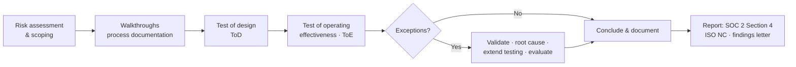
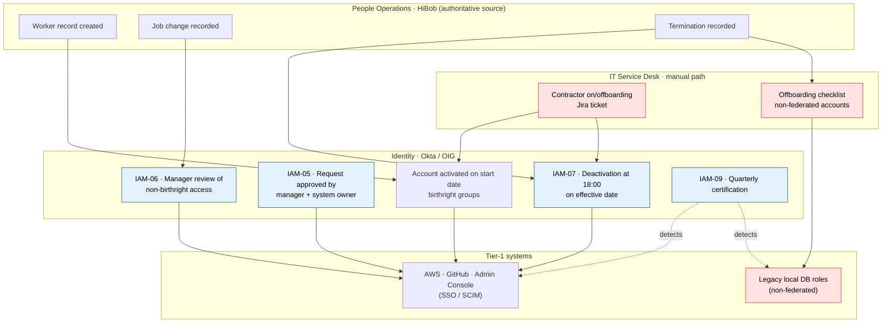

# Control Testing Program — Identity & Access Management

**Client:** Kestrel Ledger Ltd. *(fictitious)* · **Engagement:** KL-SOC2-FY26

| Field | Detail |
|---|---|
| Program reference | AP-IAM-2026 · v1.0 approved 10 Jul 2026 (plan) · v1.1 final 10 Sep 2026 (walkthrough documentation, results, quality review) |
| Report | SOC 2® Type 2 — Security category (Common Criteria) |
| Review period | 1 July 2025 – 30 June 2026 |
| Integrated work | ISO/IEC 27001:2022 surveillance audit by the firm's ISO certification team — same evidence, separate ISO report · HIPAA Security Rule mapping maintained by Kestrel |
| Criteria in focus | CC6.1, CC6.2 (primary) · CC6.3, CC6.6, CC7.2, CC7.3, CC9.2 (related) |
| Prepared by | A. Huttener — GRC Analyst *(simulated engagement)* · 10 Jul 2026 |
| Reviewed by | M. Kelly — Engagement Manager *(fictitious)* · 10 Jul 2026 |
| Approved by | J. O'Connor — Engagement Partner *(fictitious)* · 10 Jul 2026 |
| Related documents | [Risk assessment](../01-governance-and-risk/authentication-risk-assessment.md) · [Compliance mapping](../01-governance-and-risk/compliance-mapping-soc2-iso.md) · [WP-IAM-07](sample-testing-workpaper.md) · [Findings](audit-finding-and-remediation.md) · [IAM Policy](../03-policy-governance/identity-access-management-policy.md) |

---

## 1. Objective

Obtain sufficient, appropriate evidence to conclude whether the identity and access controls described in Kestrel's system description were **suitably designed** and **operated effectively throughout the review period** to meet CC6.1 and CC6.2, and whether the corresponding ISO/IEC 27001:2022 Annex A controls are effectively implemented as declared in the Statement of Applicability.

## 2. Scope

### 2.1 System and boundaries

The in-scope system is **Kestrel AP**, a multi-tenant accounts-payable automation platform hosted in AWS (eu-west-1). Identity-relevant components:

| Tier | Component | Role in the control environment |
|---|---|---|
| Tier 1 | Okta Workforce Identity + Okta Identity Governance (OIG) | Identity provider: SSO, MFA, lifecycle automation, access requests and certifications |
| Tier 1 | AWS production accounts via AWS IAM Identity Center | Production hosting; permission sets federated from Okta |
| Tier 1 | Amazon RDS for PostgreSQL (3 production instances) | Customer, invoice and supplier data (incl. bank details and some PHI) |
| Tier 1 | GitHub Enterprise Cloud | Source code and CI/CD; SAML SSO and SCIM |
| Tier 1 | Kestrel AP Admin Console | Internal support tool with access to customer tenants |
| Supporting | HiBob (HRIS) | Authoritative source for employees (and contractors from Sep 2026) |
| Supporting | Jira Service Management | Requests, approvals, on/offboarding tickets |
| Supporting | Splunk Cloud | Central log retention (≥ 400 days) and alerting |

### 2.2 Criteria in scope

| Criterion | Focus | Controls tested |
|---|---|---|
| CC6.1 | Logical access security: identification, authentication, restriction of access | IAM-01 – IAM-04, IAM-08, IAM-10 |
| CC6.2 | Registration, authorisation and removal of users | IAM-05 – IAM-07, IAM-09, IAM-11 |
| CC6.3 · CC6.6 · CC7.2 · CC7.3 · CC9.2 | Related criteria evidenced by the same controls | See [mapping](../01-governance-and-risk/compliance-mapping-soc2-iso.md) §5 |

### 2.3 Subservice organisations (carve-out method)

AWS (infrastructure) and Okta (identity platform) are carved out. The engagement team does not test their controls; instead it evaluates Kestrel's monitoring of them (control VEN-03) and the complementary subservice organisation controls (CSOCs) Kestrel relies on — see Section 6.

### 2.4 Complementary user entity controls (CUECs)

Customer users of Kestrel AP are administered by each customer. Their provisioning, removal and review are CUECs disclosed in the system description and are not tested.

### 2.5 Out of scope

Physical access (CC6.4), asset disposal (CC6.5), network segmentation, encryption and key management, and malware protection (CC6.8) are covered by other programs of this engagement.

## 3. Methodology

### 3.1 Approach

1. **Walkthroughs** (13–17 Jul 2026): trace one transaction end-to-end per process through inquiry, observation and inspection; document the process narrative and risk–control matrix (Section 4).
2. **Test of design (ToD):** would the control, operated as described by competent people, prevent or detect the risk it addresses?
3. **Test of operating effectiveness (ToE):** did the control operate consistently, as designed, throughout the full review period?

### 3.2 Testing techniques

| Technique | Description | Sufficiency |
|---|---|---|
| Inquiry | Discussion with control owners and performers | **Never sufficient on its own** — always corroborated |
| Observation | Watching the control or a report being performed (in person or screen share) | Point-in-time; supports ToD and IPE validation |
| Inspection | Examining records, approvals, configurations and logs | Primary evidence for ToE |
| Re-performance | The auditor independently executes the control or calculation | Strongest evidence; used for analytics and automated logic |

### 3.3 Automated controls and ITGC dependency

Configuration-based controls (IAM-02, IAM-03, IAM-04 configuration) are tested with a **test of one** at a point in time, supported by evidence that the configuration did not change without authorisation during the period:

- inspect the Okta System Log / AWS CloudTrail for configuration-change events across the period and agree each to an approved change ticket; and
- rely on change management ITGCs (CM-01 – CM-04, tested in a separate program). If those ITGCs were ineffective, test the configuration at multiple points in the period instead.

### 3.4 Information produced by the entity (IPE)

Any report or listing provided by Kestrel (terminations report, user listings, access-review exports) is validated before it is used as a population or as evidence:

| Check | Typical procedure |
|---|---|
| **Completeness** | Observe the report being generated; inspect parameters (date range, entities, filters); reconcile counts to an independent source (e.g., headcount roll-forward, payroll leavers) |
| **Accuracy** | Agree a selection of records to the source system; confirm field definitions (e.g., effective date vs entry date) and time-zone conversion |
| **Integrity of extraction** | Retain the query text, run timestamp and record count; for spreadsheets, confirm no manual edits after extraction |

### 3.5 Sampling methodology

Sample sizes follow the firm's attribute-sampling guidance and the [risk assessment](../01-governance-and-risk/authentication-risk-assessment.md). *Elevated risk* applies to key controls over Tier-1 systems.

**Recurring controls (by frequency)**

| Frequency | Approx. occurrences per year | Lower risk | Elevated risk |
|---|---|---|---|
| Annual | 1 | 1 | 1 |
| Quarterly | 4 | 2 | 2 |
| Monthly | 12 | 2 | 3 |
| Weekly | 52 | 5 | 10 |
| Daily | ~250 | 20 | 30 |
| Multiple times per day | > 250 | 25 | 40 |

**Event-driven controls (by population size)**

| Population | Lower risk | Elevated risk |
|---|---|---|
| 1–5 | 1 | All items |
| 6–12 | 2 | 3 |
| 13–52 | 5 | 10 |
| 53–250 | 15 | 25 |
| > 250 | 25 | 40 |

**Statistical reference.** With zero expected deviations, n = ln(risk of over-reliance) ÷ ln(1 − tolerable deviation rate): 90% confidence / 10% tolerable rate → **22**; 95% / 10% → **29**; 95% / 5% → **59** (consistent with the AICPA Audit Guide *Audit Sampling*). Selections are random (seed retained for re-performance) unless stated otherwise; stratification is used where sub-populations carry different risk.

**Deviation rule for key controls:** one deviation → validate, determine root cause and extend testing (additional items or full-population analytics where data permits); deviations confirmed → report as exceptions and evaluate per Section 3.7.

### 3.6 Evidence from compliance automation platforms

Kestrel uses a compliance automation platform (e.g., Drata or Vanta) that collects configuration and user data from Okta, AWS and GitHub through APIs. Platform evidence improves efficiency, but the engagement team treats it as **IPE**:

1. **Integration scope** — confirm which Okta org, AWS accounts and GitHub organisations are connected, and agree them to the system boundary. An unconnected production account is invisible to the platform.
2. **Data validation** — agree at least one platform extract to the source system (record counts, timestamps, key fields).
3. **No reliance on "passing" flags** — a green check is not a test result. The auditor re-performs the test against the underlying evidence (e.g., the platform reports MFA "enabled", but the auditor still inspects policy exclusions).
4. **Manual controls still need samples** — approvals and reviews are inspected item by item.
5. **Preserve evidence** — export and retain evidence at the time of testing; platform data is live and changes.

### 3.7 Evaluating exceptions

1. **Validate** with the control owner — confirm it is a real deviation, not missing evidence.
2. **Classify** — design vs operating; isolated vs systemic; identify the root cause.
3. **Quantify** — sample deviation rate; extend testing to determine the extent.
4. **Consider other evidence** — compensating controls (e.g., a detective review that caught the issue) and mitigating evidence (e.g., logs showing no misuse).
5. **Evaluate the effect** — on the control conclusion and on the criterion. Exceptions are disclosed in Section 4 of the SOC 2® report; the engagement partner considers an opinion modification only if the criterion is not met.
6. **Communicate** — written exception notice to management within two business days; agree facts; obtain management's response.
7. **ISO grading** — the ISO audit team grades the same agreed facts as a major or minor nonconformity or an opportunity for improvement, in the separate surveillance audit report.

> **Independence:** the engagement team recommends; it does not design controls, prepare management's documents, own remediation or approve risk acceptance. Management responses and action plans are management's.

### 3.8 Workpaper standards and tickmarks

Each workpaper records: objective, criteria, control description, population source and IPE validation, sample selection, attributes, results, exceptions, conclusion, and preparer/reviewer sign-off with dates. Review notes are documented and cleared before sign-off. Evidence is retained in the engagement file per firm policy.

| Tickmark | Meaning |
|---|---|
| ✓ | Agreed to source evidence without exception |
| ✗ | Exception — see exception detail |
| N/A | Attribute not applicable to the item |
| Ⓡ | Re-performed by the auditor |
| Ⓞ | Observed by the auditor |
| Ⓘ | Inquiry — corroborated by other evidence |
| § | Agreed to a system-generated report whose completeness and accuracy were validated |

## 4. Process documentation — Joiner–Mover–Leaver (JML)

Documented from walkthroughs WT-IAM-05/06/07 (13–17 Jul 2026) and confirmed with the process owners (Head of People Operations, IAM Lead, IT Service Desk Lead).

### 4.1 Process narrative

**Joiners.** People Operations creates the worker record in HiBob (start date, department, job title, manager). A nightly HiBob → Okta integration stages the Okta account, which activates at 07:00 on the start date with *birthright* groups assigned from the role-based access matrix owned by system owners. Any additional Tier-1 entitlement is requested in OIG and approved by the line manager, then the system owner; OIG then provisions it (AWS permission sets via Identity Center, GitHub teams via SCIM, Admin Console roles via SAML attributes). *Contractors (until Sep 2026):* the hiring manager raises a Jira onboarding request with the signed contract and the IT Service Desk creates the Okta account manually.

**Movers.** A job or department change in HiBob updates Okta attributes: birthright groups change automatically and OIG opens a review task for the new manager covering any access outside the new birthright set, to be completed within 5 business days.

**Leavers.** People Operations records the termination in HiBob. Okta deactivates the account at 18:00 on the effective date (immediately for involuntary exits, via an urgent-termination workflow), ending SSO sessions and triggering SCIM deprovisioning. HiBob also opens a Jira offboarding ticket with a checklist covering non-federated accounts, devices and shared vault items. *Contractors:* the hiring manager raises the offboarding ticket and the IT Service Desk deactivates the account manually. *Legacy local database roles:* dropped by a DBA when instructed by the checklist.

**Detective layer.** Quarterly OIG certifications (IAM-09) cover all Tier-1 systems, including RDS login roles.

### 4.2 Process flow and control points

*Red nodes are manual paths identified as design risks during the walkthrough; blue nodes are tested controls.*

### 4.3 Risk–control matrix (RCM)

| Risk ID | What could go wrong | Control(s) | Type | Key | Criteria |
|---|---|---|---|---|---|
| JML-R1 | Access is granted without authorisation or beyond what the role needs | IAM-05 | Preventive · IT-dependent manual | Yes | CC6.2, CC6.3 |
| JML-R2 | Workers who change role accumulate access they no longer need | IAM-06 · IAM-09 | Preventive · Detective | No · Yes | CC6.2, CC6.3 |
| JML-R3 | Leavers retain access after exit | IAM-07 | Preventive | Yes | CC6.2 |
| JML-R4 | Contractors retain access after contract end | IAM-11 · IAM-07 | Preventive · Detective | Yes | CC6.2, CC9.2 |
| JML-R5 | Non-federated accounts sit outside the automated lifecycle and are not removed | IAM-07 (checklist) · IAM-09 | Preventive (manual) · Detective | Yes | CC6.1, CC6.2 |
| JML-R6 | Inappropriate access persists undetected | IAM-09 | Detective | Yes | CC6.2, CC6.3 |

### 4.4 Design observations carried into testing

1. Contractor exits depend on a manager remembering to raise a ticket — **no automated trigger or end date**.
2. Five legacy local PostgreSQL roles are **not linked to identities** in any authoritative inventory; removal depends on technician judgement.
3. The "next business day" SLA permits access to persist over weekends and public holidays for planned exits.

Observations 1 and 2 are **design weaknesses** in manual paths: each has an owner and a ticketed procedure, but no reliable trigger or reference data. They were targeted in ToE through stratified sampling, **planned 100% analytics** over contractors and non-federated accounts, and extended procedures (see [WP-IAM-07](sample-testing-workpaper.md)).

## 5. Control test procedures

Population counts are for the review period. "WT" = walkthrough memo; "WP" = workpaper.

### IAM-01 — IAM policy governance · *Key*

| | |
|---|---|
| Control | IAM-POL-001 and supporting standards are approved by the ISSC at least annually, published on the intranet and acknowledged by the workforce at onboarding |
| Owner · nature · frequency | CISO · directive, manual · annual (acknowledgement: as needed) |
| Criteria | CC2.2, CC5.3, CC6.1 · ISO A.5.1, A.5.15 |
| Population / IPE | Policy version history; ISSC minutes; HiBob acknowledgement report |
| Sample | 1 approval in period + 25 acknowledgements (reuses the IAM-05 joiner sample) |

**ToD:** Inquire of the CISO about the policy lifecycle; inspect the policy for required content (scope, roles, lifecycle, authentication, privileged access, reviews, exceptions).
**ToE:** (1) Inspect ISSC minutes approving v3.1 on 20 Jan 2026 and confirm it was within 12 months of the v3.0 approval (22 Jan 2025). (2) Inspect intranet publication. (3) For the 25 joiners sampled under IAM-05, inspect acknowledgement within 30 days of start.

### IAM-02 — Centralised identity, SSO and unique IDs · *Key*

| | |
|---|---|
| Control | All workforce access to Tier-1 systems authenticates through Okta SSO using unique, named identities; local authentication is disabled where supported; shared accounts are prohibited unless approved as exceptions |
| Owner · nature · frequency | IAM Lead · preventive, automated (configuration) · continuous |
| Criteria | CC6.1 · ISO A.5.16, A.8.5 · HIPAA §164.312(a)(2)(i) |
| Population / IPE | SSO configuration per Tier-1 system; Okta user export at 30 Jun 2026 (418 active users) |
| Sample | Test of one per Tier-1 system + 100% analytics |

**ToD:** Walk through sign-in to each Tier-1 system; inspect SAML/OIDC settings and SSO enforcement (e.g., GitHub SAML enforcement, Identity Center external IdP).
**ToE:** (1) Inspect SSO enforcement for each Tier-1 system. (2) Inspect configuration-change events in the period and agree each to an approved change (Section 3.3). (3) Analytics over the full Okta export: duplicate employee IDs, generic names (e.g., "admin", "test", "shared"), users with no match in HiBob or the contractor register. (4) Inspect local user listings (AWS IAM credential report, GitHub outside collaborators, RDS login roles) for non-federated human accounts — results feed IAM-07 extended procedures.

### IAM-03 — Multi-factor authentication · *Key*

| | |
|---|---|
| Control | Okta authentication policies require MFA for all users and applications; SMS, voice and email factors are disabled; exclusions are limited to the two break-glass accounts governed by IAM-08 |
| Owner · nature · frequency | IAM Lead · preventive, automated · continuous |
| Criteria | CC6.1, CC6.6 · ISO A.5.17, A.8.5 · HIPAA §164.312(d) |
| Population / IPE | Okta authentication and global session policies; authenticator enrollment report (all users) |
| Sample | Test of one + 100% enrollment analytics |

**ToD:** Inspect policy rule order and conditions; observe the control owner signing in to a Tier-1 application and receiving an MFA challenge.
**ToE:** (1) Inspect policies and authenticator settings at 30 Jun 2026 and change history for the period. (2) Confirm 100% of active users are enrolled in at least one permitted authenticator. (3) Inspect groups or rules that bypass MFA — limited to break-glass accounts. (4) Record authenticator types used by privileged identities (input to OBS-2026-01).

### IAM-04 — Authentication configuration and authenticator resets · *Non-key*

| | |
|---|---|
| Control | Okta password settings comply with the Authentication Standard (IAM-STD-02); authenticator and password resets require identity verification by live video with photo-ID match plus manager confirmation through a separate channel |
| Owner · nature · frequency | IAM Lead; IT Service Desk Lead · preventive, automated + manual · continuous / as needed |
| Criteria | CC6.1 · ISO A.5.17, A.8.5 · HIPAA §164.308(a)(5)(ii)(D) |
| Population / IPE | Okta password policy; Jira authenticator-reset tickets (146) |
| Sample | Test of one (configuration) + 25 of 146 resets |

**ToD:** Compare configuration to IAM-STD-02 (minimum 14 characters, common-password check, lockout after 10 failed attempts, no composition rules, no periodic expiry); walk through one reset.
**ToE:** (1) Inspect configuration and change history. (2) For 25 resets: verification evidence recorded (ID match and manager confirmation); reset performed by service-desk staff, not the requester; user notified; ticket closed.

### IAM-05 — Joiners (provisioning) · *Key*

| | |
|---|---|
| Control | Birthright access is assigned automatically from HiBob role attributes; any additional Tier-1 entitlement is requested in OIG and approved by the line manager and system owner before it is granted |
| Owner · nature · frequency | System owners; IAM Lead · preventive, IT-dependent manual · as needed |
| Criteria | CC6.2, CC6.3 · ISO A.5.15, A.5.18, A.8.3 · HIPAA §164.308(a)(4)(ii)(B) |
| Population / IPE | HiBob new-hires report (87) + contractor onboardings from the register (25) = **112** |
| Sample | 25 of 112 |

**ToD:** Trace one employee joiner and one OIG request end-to-end; inspect the role-based access matrix.
**ToE:** For each item: (a) Okta account activated on or after the start date; (b) birthright groups agree to the role matrix; (c) each Tier-1 entitlement approved by manager and system owner before the grant; (d) approver differs from requester and provisioner; (e) policy acknowledgement (IAM-01).

### IAM-06 — Movers (access modification) · *Non-key*

| | |
|---|---|
| Control | Job changes in HiBob trigger an OIG review; entitlements not required by the new role are removed within 5 business days |
| Owner · nature · frequency | Line managers; IAM Lead · preventive, IT-dependent manual · as needed |
| Criteria | CC6.2, CC6.3 · ISO A.5.18, A.6.5 · HIPAA §164.308(a)(4)(ii)(C) |
| Population / IPE | HiBob job-change report (**38**) |
| Sample | 10 of 38 |

**ToE:** For each item, compare Tier-1 entitlements before and after the change; confirm entitlements outside the new role were removed within 5 business days; confirm new entitlements were approved per IAM-05.

### IAM-07 — Leavers (deprovisioning) · *Key*

| | |
|---|---|
| Control | Exits recorded in HiBob (employees) or notified by ticket (contractors) result in Okta deactivation by the end of the next business day after the effective date — same day for involuntary exits; non-federated accounts are removed in the same timeframe via the offboarding checklist |
| Owner · nature · frequency | Head of People Operations; IT Service Desk Lead · preventive, automated (employees) / manual (contractors, non-federated accounts) · as needed |
| Criteria | CC6.2, CC6.3 · ISO A.5.18, A.6.5 · HIPAA §164.308(a)(3)(ii)(C) |
| Policy in effect | IAM-POL-001 v3.0 (to 19 Jan 2026) and v3.1 (from 20 Jan 2026), §6.4 |
| Population / IPE | HiBob terminations (69) + contractor register exits (15) = **84**; Okta lifecycle events via Splunk |
| Sample | 25 of 84, stratified (20 employees, 5 contractors) + full-population analytics |

**ToE:** Attributes A–E and extended procedures are documented in **[WP-IAM-07](sample-testing-workpaper.md)** — the sample workpaper for this program.

### IAM-08 — Privileged access management · *Key*

| | |
|---|---|
| Control | Privileged roles are available only to CISO-approved eligible identities, through just-in-time elevation (≤ 4 hours) with justification and independent approval; Okta administrators use separate admin identities; two break-glass accounts are sealed under dual control and monitored |
| Owner · nature · frequency | CISO; Cloud Platform Lead · preventive, automated + manual approval · as needed |
| Criteria | CC6.1, CC6.3 · ISO A.5.3, A.8.2, A.8.18 · HIPAA §164.312(a)(2)(ii) |
| Population / IPE | Eligibility list (**21**); elevation log (**214**); break-glass use log (**2**) |
| Sample | 100% eligibility; 25 of 214 elevations; 100% of break-glass uses |

**ToD:** Walk through an elevation from request to automatic expiry; inspect the break-glass procedure and safe log.
**ToE:** (1) For all 21 eligible identities: CISO and system-owner approval, documented justification, separate admin identity for Okta roles. (2) For 25 elevations: justification and ticket reference; approver differs from requester; duration ≤ 4 hours; expiry evidenced in logs. (3) Standing (non-JIT) privileged assignments at 30 Jun 2026 limited to break-glass and two CISO-approved platform roles. (4) Break-glass uses on 14 Aug 2025 and 12 Feb 2026 (semi-annual tests): alert raised, post-use review, credential rotation, safe access logged.

### IAM-09 — User access reviews · *Key*

| | |
|---|---|
| Control | Each quarter, system owners certify user and privileged access for the five Tier-1 systems using system-generated listings; reviews are completed within 30 days of quarter end and changes actioned within 10 business days (2 for privileged access) |
| Owner · nature · frequency | System owners; GRC Manager (coordination) · detective, IT-dependent manual · quarterly |
| Criteria | CC6.2, CC6.3 · ISO A.5.18 · HIPAA §164.308(a)(1)(ii)(D) |
| Population / IPE | 4 review cycles × 5 systems = **20** review instances; spreadsheets (Q3 2025) and OIG campaign exports (from Q4 2025) |
| Sample | 2 cycles (10 instances): Q3 2025 and Q1 2026 — extended to the Q4 2025 cycle after exceptions |

**ToD:** Walk through one OIG campaign, including how each listing is generated (IPE).
**ToE attributes:** (A) review performed for every Tier-1 system; (B) listing system-generated, with source, parameters and extraction date evidenced; (C) reviewer appropriate — no self-certification; (D) completed within 30 days of quarter end; (E) revocations actioned within SLA and verified; (F) sign-off evidence retained.

### IAM-10 — Non-human identities · *Non-key*

| | |
|---|---|
| Control | Non-human identities are registered with an owner and purpose, cannot log in interactively, keep secrets in AWS Secrets Manager with rotation ≤ 90 days (or use short-lived credentials), and are reviewed quarterly within IAM-09 |
| Owner · nature · frequency | Cloud Platform Lead · preventive/detective, manual + automated rotation · continuous / quarterly |
| Criteria | CC6.1, CC6.2 · ISO A.5.16, A.5.17 |
| Population / IPE | NHI inventory (**31**); Okta API tokens, GitHub Apps and deploy keys, RDS application roles, Secrets Manager rotation report |
| Sample | 100% of inventory; NHI review in 2 of 4 cycles |

**ToE:** (1) Two-way completeness check between the inventory and system listings. (2) For all 31: owner, purpose, interactive login disabled, secret vaulted, rotation evidence. (3) Quarterly review evidence for 2 cycles.

### IAM-11 — Contractor and third-party access · *Key*

| | |
|---|---|
| Control | Contractor access requires a named Kestrel sponsor, a signed agreement with confidentiality terms and system-owner approval; sponsors re-certify contractor access every 90 days |
| Owner · nature · frequency | Sponsors; Procurement; IAM Lead · preventive/detective, manual · as needed / quarterly |
| Criteria | CC6.2, CC9.2 · ISO A.5.18, A.5.19, A.5.20 |
| Population / IPE | Contractor onboardings (**25**); sponsor re-certification cycles (**4**) |
| Sample | 10 of 25 onboardings; 2 of 4 re-certification cycles |

**Design note:** under v3.0/v3.1 contractor access had **no automated expiry** at contract end — removal depended on IAM-07 manual notification (design weakness, Section 4.4).
**ToE:** (1) For 10 onboardings: signed agreement, named sponsor, system-owner approval, end date recorded in the register. (2) For 2 re-certification cycles: completed within 15 days of cycle start; removals actioned.

### IAM-12 — Authentication logging and monitoring · *Key*

| | |
|---|---|
| Control | Okta, CloudTrail, GitHub audit and RDS pgaudit logs are forwarded to Splunk Cloud and retained ≥ 400 days; rules alert on anomalous authentication (password spraying, repeated MFA denials, privileged sign-in from a new country, privileged role assignment outside JIT, any break-glass use); alerts are triaged within SLA (High 1 hour, Medium 24 hours) |
| Owner · nature · frequency | Security Operations Lead · detective, automated alerting + manual triage · continuous |
| Criteria | CC7.2, CC7.3 (supports CC6.1) · ISO A.8.15, A.8.16 · HIPAA §164.312(b), §164.308(a)(5)(ii)(C) |
| Population / IPE | Splunk alerts and triage tickets (**318**) |
| Sample | Test of one per rule (5) + 40 of 318 alerts |

**ToE:** (1) Inspect retention settings and ingestion-health monitoring. (2) Inspect rule logic and change history. (3) For 40 alerts: triaged within SLA, disposition documented, escalated to an incident where criteria were met.

## 6. Vendor oversight — subservice organisation report review

Under the carve-out method Kestrel relies on CSOCs at AWS and Okta, so the engagement team re-performs Kestrel's annual review (control **VEN-03**, part of Kestrel's third-party risk management program).

### 6.1 Review procedure

| # | Step | What the reviewer checks |
|---|---|---|
| 1 | Report type and scope | SOC 2® **Type 2** (not Type 1 or SOC 3); the services and regions Kestrel uses are in scope |
| 2 | Period coverage | Overlap with Kestrel's period; any gap at period end covered by a **bridge letter** |
| 3 | Opinion | Unmodified? If modified, which criteria — and does that affect a CSOC Kestrel relies on? |
| 4 | Exceptions | Each exception in Section 4 assessed for relevance to the CSOCs, with the vendor's management response |
| 5 | CUECs | Every relevant user-entity control mapped to a Kestrel control that operates |
| 6 | Fourth parties | The vendor's own subservice organisations and how they are treated (carve-out / inclusive) |
| 7 | Conclusion | Documented conclusion, follow-up items and the next review date |

### 6.2 Results

*Illustrative outcomes for this simulated engagement — not a description of any actual AWS or Okta report.*

| Step | AWS | Okta |
|---|---|---|
| Report type and scope | SOC 2® Type 2; services used by Kestrel in scope | SOC 2® Type 2; workforce identity services in scope |
| Period coverage | Overlaps most of Kestrel's period; bridge letter obtained for the remaining months | Overlaps most of Kestrel's period; bridge letter obtained for the remaining months |
| Opinion | Unmodified | Unmodified |
| Exceptions relevant to CSOCs | None noted | None noted |
| CUECs mapped | Mapped to IAM-02, IAM-08, IAM-10, IAM-12 | Mapped to IAM-03, IAM-04, IAM-08, IAM-12 |
| Conclusion | No impact on Kestrel's CC6 controls | No impact; obtain next report on issuance |

### 6.3 Worked example — evaluating an exception in a vendor report *(hypothetical)*

> *A vendor's report discloses that 2 of 25 sampled changes to its authentication service lacked documented approval.*
>
> **Evaluation:** (1) Relevance — the CSOC Kestrel relies on is "authentication policies are enforced as configured", so change management over that service is relevant. (2) Severity — opinion unmodified; vendor reports both changes were later reviewed with no impact. (3) Kestrel's compensating evidence — Okta policy changes are monitored by IAM-12 and IAM-02 change-log reviews; no unexpected policy changes in the period. (4) Conclusion — no impact on reliance; request the vendor's remediation status and re-check in the next report. (5) Record in the vendor risk register.

## 7. Provided-by-client (PBC) request list

| ID | Request | Control(s) | Due |
|---|---|---|---|
| PBC-01 | IAM-POL-001 v3.0 and v3.1; ISSC approval minutes | IAM-01 | 13 Jul 2026 |
| PBC-02 | Policy acknowledgement report (HiBob) | IAM-01 | 13 Jul 2026 |
| PBC-03 | Draft system description (Section 3) and boundary diagram | All | 13 Jul 2026 |
| PBC-04 | HiBob terminations report for the period — **generation observed** | IAM-07 | 14 Jul 2026 |
| PBC-05 | HiBob new-hires and job-change reports — **generation observed** | IAM-05, IAM-06 | 14 Jul 2026 |
| PBC-06 | Contractor register (start and end dates) | IAM-07, IAM-11 | 14 Jul 2026 |
| PBC-07 | Okta active-user export and authenticator enrollment report at 30 Jun 2026 | IAM-02, IAM-03 | 15 Jul 2026 |
| PBC-08 | Okta System Log extracts via Splunk: lifecycle, policy changes, admin role grants | IAM-02, IAM-03, IAM-07, IAM-08 | 17 Jul 2026 |
| PBC-09 | Okta authentication, password and session policies (screenshots and API export) | IAM-03, IAM-04 | 15 Jul 2026 |
| PBC-10 | Service-desk reset procedure and reset ticket population | IAM-04 | 17 Jul 2026 |
| PBC-11 | OIG access-request and certification campaign exports; Q3 2025 review spreadsheets | IAM-05, IAM-09 | 17 Jul 2026 |
| PBC-12 | Identity Center permission-set assignments; elevation events (CloudTrail) | IAM-08 | 17 Jul 2026 |
| PBC-13 | RDS login-role listings per production instance; pgaudit configuration — **query observed** | IAM-07, IAM-10 | 17 Jul 2026 |
| PBC-14 | GitHub Enterprise membership and audit-log export | IAM-02, IAM-05 | 17 Jul 2026 |
| PBC-15 | Admin Console role listing | IAM-05, IAM-09 | 17 Jul 2026 |
| PBC-16 | NHI inventory and Secrets Manager rotation report | IAM-10 | 17 Jul 2026 |
| PBC-17 | Break-glass procedure, safe log and use records | IAM-08 | 17 Jul 2026 |
| PBC-18 | Splunk retention settings, detection rules, alert and triage tickets | IAM-12 | 17 Jul 2026 |
| PBC-19 | AWS and Okta SOC 2® Type 2 reports, bridge letters and Kestrel's VEN-03 review | VEN-03 | 17 Jul 2026 |
| PBC-20 | Management representation letter, dated as of the report date | All | 11 Sep 2026 |

## 8. Timeline

| Phase | Dates | Output |
|---|---|---|
| Planning and risk assessment | 1–30 Jun 2026 | Risk assessment v1.0 (12 Jun); planning memo |
| Program approval | 10 Jul 2026 | This program v1.0 |
| Walkthroughs (ToD) and process documentation | 13–17 Jul 2026 | WT memos; Section 4 |
| Operating-effectiveness fieldwork | 20 Jul – 7 Aug 2026 | WP-IAM-01 – WP-IAM-12 |
| Exception notices | 27 Jul 2026 (sample exceptions) · 10 Aug 2026 (full-population update) | Written notices within two business days of confirmation |
| Validation meeting · partner review | 12 Aug 2026 | Agreed facts; engagement partner concurrence |
| Management responses due | 21 Aug 2026 | Responses and action plans |
| Closing meeting · draft report | 27–28 Aug 2026 | Draft SOC 2® report; findings report |
| Engagement quality review | 1–10 Sep 2026 | Review of the report and key judgements before issuance |
| Final report · representation letter | 11 Sep 2026 | SOC 2® Type 2 report issued; letter dated as of the report date |

## 9. Summary of results

| Control | Key | Method / sample | Deviations | Conclusion | Ref |
|---|---|---|---|---|---|
| IAM-01 | Yes | 1 approval; 25 acknowledgements | 0 | Operating effectively | WP-IAM-01 |
| IAM-02 | Yes | Test of one × 5 systems; 100% analytics (418 users) | 0 | Operating effectively | WP-IAM-02 |
| IAM-03 | Yes | Test of one; 100% enrollment | 0 | Operating effectively — see OBS-2026-01 | WP-IAM-03 |
| IAM-04 | No | Test of one; 25 of 146 resets | 0 | Operating effectively | WP-IAM-04 |
| IAM-05 | Yes | 25 of 112 | 0 | Operating effectively | WP-IAM-05 |
| IAM-06 | No | 10 of 38 | 0 | Operating effectively | WP-IAM-06 |
| **IAM-07** | Yes | 25 of 84 + 100% analytics | **2 of 25 sampled · 6 of 84 in population** | **Exceptions noted** — IAM-2026-01 | [WP-IAM-07](sample-testing-workpaper.md) |
| IAM-08 | Yes | 21 eligibility (100%); 25 of 214 elevations; 2 break-glass uses | 0 | Operating effectively | WP-IAM-08 |
| **IAM-09** | Yes | 10 of 20 instances + 5 extended | **5 of 10 (Q3 2025 cycle)** | **Exceptions noted** — IAM-2026-02 (remediated from Q4 2025) | WP-IAM-09 |
| IAM-10 | No | 31 NHIs (100%); 2 of 4 reviews | 0 | Operating effectively | WP-IAM-10 |
| IAM-11 | Yes | 10 of 25; 2 of 4 re-certifications | 0 | Operating effectively — design weakness carried into IAM-2026-01 | WP-IAM-11 |
| IAM-12 | Yes | 5 rules; 40 of 318 alerts | 0 | Operating effectively | WP-IAM-12 |

**Overall:** 12 controls tested (9 key). Exceptions in 2 controls, both reported in Section 4 of the SOC 2® report. The engagement team concluded that CC6.1 and CC6.2 were met — no opinion modification — based on the overall evaluation: all 69 automated employee exits were deprovisioned on time; deviations were confined to two manual sub-populations; IAM-05, IAM-06 and IAM-11 operated effectively; IAM-09 detected the most sensitive case; and complete logs showed no access after exit (engagement partner concurrence 12 Aug 2026; engagement quality review completed 10 Sep 2026). Findings, ratings and management responses are in the [findings report](audit-finding-and-remediation.md).

## 10. Sign-off

| Role | Name | Date |
|---|---|---|
| Preparer | A. Huttener — GRC Analyst *(simulated)* | 10 Jul 2026 (plan) · 14 Aug 2026 (results) |
| Reviewer | M. Kelly — Engagement Manager *(fictitious)* | 10 Jul 2026 (plan) · 14 Aug 2026 (results) |
| Approver | J. O'Connor — Engagement Partner *(fictitious)* | 10 Jul 2026 (plan) · 10 Sep 2026 (final, after quality review) |
