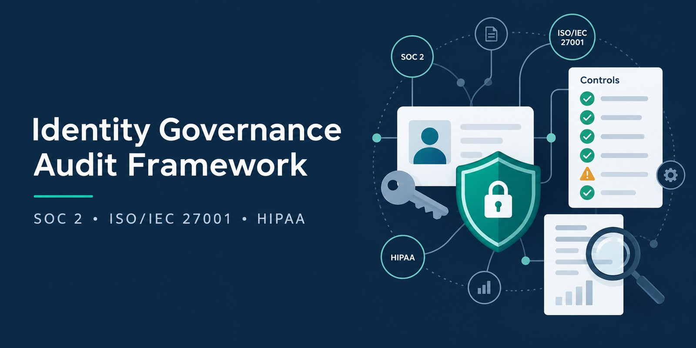
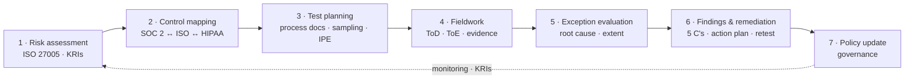

# Identity Governance Audit Framework

**An end-to-end GRC and IT audit case study: evaluating identity and access management (IAM) controls against SOC 2® (CC6.1, CC6.2), ISO/IEC 27001:2022 and the HIPAA Security Rule — from risk assessment to tested evidence, findings and remediation.**

    

> [!IMPORTANT]
> **Simulated engagement.** Kestrel Ledger Ltd. and all people, systems, identifiers and data in this repository are **fictitious**, created for education and portfolio purposes. Nothing here is an actual SOC 2® report, attestation opinion or ISO/IEC 27001 certification — SOC 2® examinations can only be performed by licensed CPA firms. Real products (Okta, AWS, GitHub, HiBob, Splunk) appear only as a realistic technology stack; any outcomes attributed to them are illustrative. AICPA and ISO requirement text is copyrighted, so criteria are paraphrased and cited by identifier.

## In 60 seconds

A fictitious Dublin SaaS company holds customer payment data and some US healthcare data. I documented both sides of a simulated audit of its identity controls — the client's governance documents and the auditor's testing — for a SOC 2® Type 2 examination integrated with an ISO/IEC 27001 surveillance audit, plus a HIPAA mapping:

- **12 controls** mapped once to SOC 2®, ISO/IEC 27001, HIPAA, NIST CSF 2.0 and CIS v8.1 — *test once, satisfy many*.
- **Leaver testing:** a stratified sample of 25 out of 84 exits found 2 exceptions; full-population analytics then showed **6 of 84** exits revoked late, all in two manual paths (contractors and legacy database accounts).
- **Evaluation:** deviations were confined to two manual sub-populations and complete logs showed no access after exit, so the SOC 2® opinion was not modified — but the finding was still rated **High** because the root causes were systemic.
- **Outcome:** a 5-C finding, management action plan, ISO minor nonconformity, HIPAA breach assessment, a retest plan and an updated policy (v3.2).

## What this repository demonstrates

| GRC analyst responsibility | Where it is demonstrated |
|---|---|
| **Testing control effectiveness** — walkthroughs, test of design vs. operating effectiveness, sampling, IPE validation, exceptions, extended procedures | [Sample testing workpaper (WP-IAM-07)](02-audit-testing-workpapers/sample-testing-workpaper.md) · [Control testing program](02-audit-testing-workpapers/control-testing-program.md) §3, §5 |
| **Documenting business processes** — joiner–mover–leaver narrative, process flow, risk–control matrix | [Control testing program](02-audit-testing-workpapers/control-testing-program.md) §4 |
| **Risk management** — likelihood × impact, inherent vs. residual risk, risk appetite, KRIs, treatment plans | [Authentication risk assessment](01-governance-and-risk/authentication-risk-assessment.md) |
| **Framework knowledge** — SOC 2® points of focus, ISO/IEC 27001 Statement of Applicability, HIPAA required vs. addressable, EU overlay | [Compliance mapping](01-governance-and-risk/compliance-mapping-soc2-iso.md) |
| **Third-party / vendor risk** — reviewing subservice organisations' SOC 2® reports, CSOCs, CUECs, bridge letters, carve-out method | [Control testing program](02-audit-testing-workpapers/control-testing-program.md) §6 · [Compliance mapping](01-governance-and-risk/compliance-mapping-soc2-iso.md) §9 |
| **Communicating findings to stakeholders** — 5-C findings, management responses, SOC 2® report wording, exception notice, handling pushback | [Findings & remediation](02-audit-testing-workpapers/audit-finding-and-remediation.md) |
| **Policy governance** — the policy as audit criteria, updated in response to findings | [IAM Policy v3.2](03-policy-governance/identity-access-management-policy.md) |
| **Working with compliance automation platforms** — treating platform evidence as IPE | [Control testing program](02-audit-testing-workpapers/control-testing-program.md) §3.6 |

## Engagement snapshot *(fictitious)*

| Item | Detail |
|---|---|
| Client | Kestrel Ledger Ltd. — Dublin-based B2B SaaS provider of accounts-payable automation ("Kestrel AP"), ~600 customers in Ireland, the UK and the US |
| Engagement | SOC 2® Type 2 — Security (Common Criteria), integrated with the ISO/IEC 27001:2022 surveillance audit (same evidence, separate ISO report); HIPAA Security Rule mapping (Kestrel is a business associate for some US healthcare customers) |
| Review period | 1 July 2025 – 30 June 2026 |
| Focus | CC6.1 (logical access security) and CC6.2 (registration, authorisation and removal of users); related CC6.3, CC7.2, CC9.2 |
| Identity stack | Okta (SSO, MFA, Identity Governance) · HiBob (HRIS) · AWS IAM Identity Center · Amazon RDS for PostgreSQL · GitHub Enterprise Cloud · Splunk Cloud |
| Subservice organisations | AWS and Okta — carve-out method |
| Workforce | ~420 identities (380 employees, 38 contractors), 21 privileged identities, 31 non-human identities |

## Roles in this simulation

I authored every document to make the case realistic, but kept the roles separate — exactly as independence rules require.

| Folder | Whose document | Why it matters |
|---|---|---|
| `01-governance-and-risk` | **Kestrel management** (GRC Manager, CISO) | The client owns its risk assessment and control framework. The auditor evaluates them (e.g., CC3.2) but does not prepare them |
| `02-audit-testing-workpapers` | **Service auditor** (CPA firm engagement team, GRC Analyst as preparer) | Independent testing, exceptions, findings and report wording |
| `03-policy-governance` | **Kestrel management** (CISO, ISSC) | The criteria the controls are tested against |

> Under AICPA independence rules, an auditor that wrote the client's risk assessment, designed its controls or ran its internal audit would be **auditing its own work** (a self-review threat). The auditor recommends; management decides, owns and implements.

## Audit lifecycle



## Results at a glance

| Metric | Result |
|---|---|
| Controls tested | 12 (IAM-01 – IAM-12), 9 key controls |
| Operated without exception | 10 of 12 |
| Controls with exceptions | IAM-07 (leavers) · IAM-09 (user access reviews) |
| Findings | 1 **High** · 1 **Moderate** (remediated during the period) · 1 **Observation** |
| SOC 2® reporting | Exceptions disclosed in Section 4 · no opinion modification (deviations confined to two manual sub-populations; no access after exit) |
| ISO/IEC 27001 surveillance audit | 1 minor nonconformity open (corrective action plan accepted) · 1 minor nonconformity closed at audit · 1 opportunity for improvement |
| HIPAA | Termination procedure not consistently applied; breach assessment concluded no use or disclosure of PHI |

## Repository structure

```text
identity-governance-audit-framework/
├── README.md
├── 01-governance-and-risk/                  # CLIENT (management) documents
│   ├── authentication-risk-assessment.md   # Risk register, heat map, appetite, KRIs, treatment plan
│   └── compliance-mapping-soc2-iso.md      # CC6.1/CC6.2 points of focus, ISO SoA, HIPAA, CSOC/CUEC
├── 02-audit-testing-workpapers/             # AUDITOR documents
│   ├── control-testing-program.md          # Methodology, JML process docs + RCM, 12 test procedures, vendor review
│   ├── sample-testing-workpaper.md         # WP-IAM-07: 25-item sample, exceptions, full-population analytics
│   └── audit-finding-and-remediation.md    # Findings (5 C's), SOC 2 wording, tracker, exception notice
└── 03-policy-governance/                    # CLIENT (management) document
    └── identity-access-management-policy.md # IAM-POL-001 v3.2 — the criteria under audit, updated post-audit
```

## Suggested reading order (10 minutes)

1. **Results at a glance** (above)
2. [WP-IAM-07](02-audit-testing-workpapers/sample-testing-workpaper.md) — §7 results table, §8 exceptions, §10 evaluation
3. [Finding IAM-2026-01](02-audit-testing-workpapers/audit-finding-and-remediation.md) — how the exception becomes a finding and a report disclosure
4. [Process documentation](02-audit-testing-workpapers/control-testing-program.md) — §4 narrative, flow and risk–control matrix
5. [Unified control matrix](01-governance-and-risk/compliance-mapping-soc2-iso.md) — §6

## Key concepts used

| Concept | Meaning in this repository |
|---|---|
| Test of design (ToD) | Would the control, operated as described, prevent or detect the risk? Assessed through walkthroughs |
| Test of operating effectiveness (ToE) | Did the control operate consistently throughout the period? Required for SOC 2® Type 2 |
| IPE | Information produced by the entity (e.g., a terminations report) — its completeness and accuracy are validated before use |
| Attribute sampling | Testing a sample for defined attributes and evaluating deviations against a tolerable rate |
| Extended procedures | Additional testing after an exception to determine whether it is isolated or systemic |
| Carve-out method · CSOC | A vendor's controls are excluded from scope; the controls the company relies on them for are disclosed as complementary subservice organisation controls |
| CUEC | Complementary user entity control — what the customer must do for the criteria to be met |
| Bridge letter | A vendor's statement covering the gap between its SOC report period end and the user's period end |
| Exception vs. qualified opinion | Exceptions are disclosed in Section 4; the opinion is modified only if a criterion is not met |
| Major / minor nonconformity · OFI | ISO/IEC 27001 grading of audit findings |
| Required vs. addressable | HIPAA implementation specifications — "addressable" means implement if reasonable and appropriate, or document an equivalent alternative |
| Compensating vs. mitigating | A compensating control addresses the same risk when the primary control fails; mitigating factors reduce the impact or likelihood of a specific failure (e.g., logs showing no access) |
| Independence · self-review threat | The auditor must not prepare, design or operate what it later tests — management owns its controls and documents |

## Standards and references

- AICPA — 2017 Trust Services Criteria (with Revised Points of Focus — 2022), TSP Section 100; DC 200 description criteria; SOC 2® Guide; Audit Guide *Audit Sampling*
- ISO/IEC 27001:2022 (incl. Amd 1:2024) · ISO/IEC 27002:2022 · ISO/IEC 27005:2022 · ISO 31000:2018 · ISO 19011:2018
- HIPAA Security Rule — 45 CFR Part 164, Subpart C
- NIST CSF 2.0 · NIST SP 800-63B-4 · NIST SP 800-30 Rev. 1
- CIS Critical Security Controls v8.1
- GDPR Art. 32 · NIS2 Directive Art. 21 · DORA Art. 9

## Scope boundaries

This repository takes an **assurance perspective**: controls are evaluated through inquiry, observation, inspection and re-performance of evidence. It intentionally contains no penetration testing, exploit code or offensive tooling.

## Author

**Adriano Huttener** — MSc in Cybersecurity candidate, National College of Ireland · [github.com/ahuttener](https://github.com/ahuttener)

Feedback from GRC and audit practitioners is welcome via issues.

*© 2026 Adriano Huttener. Shared for educational and portfolio purposes.*
